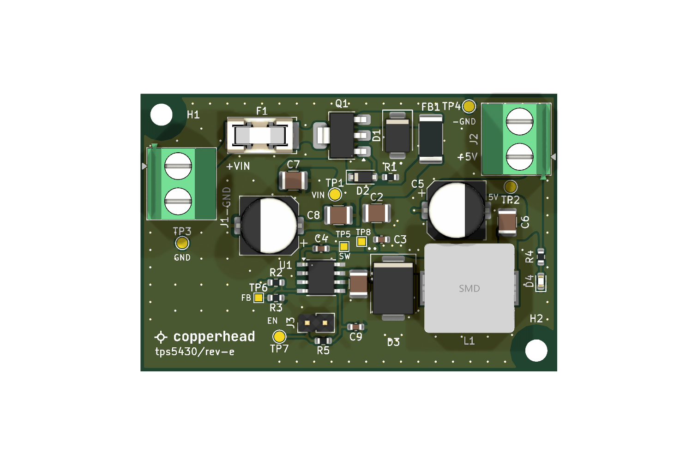
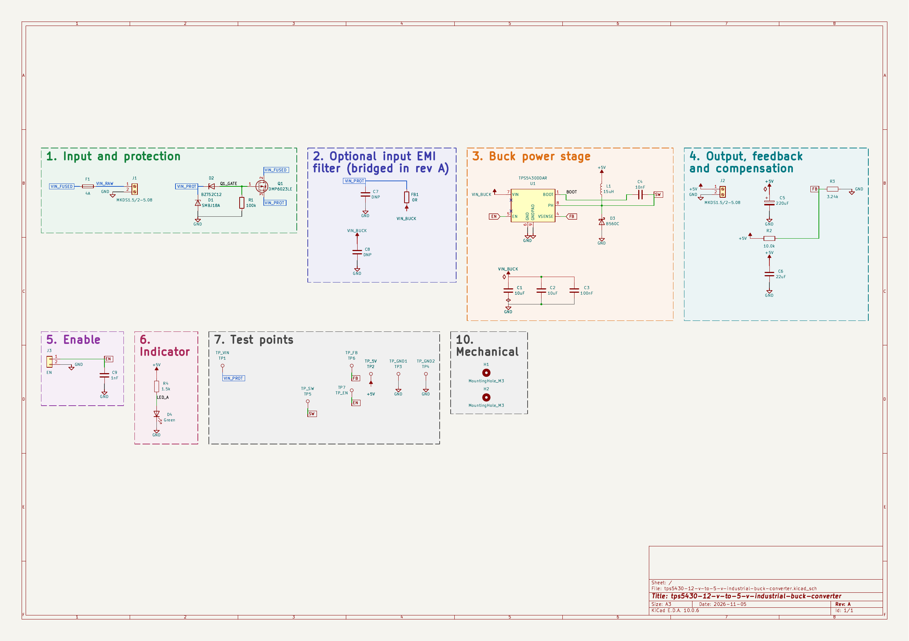
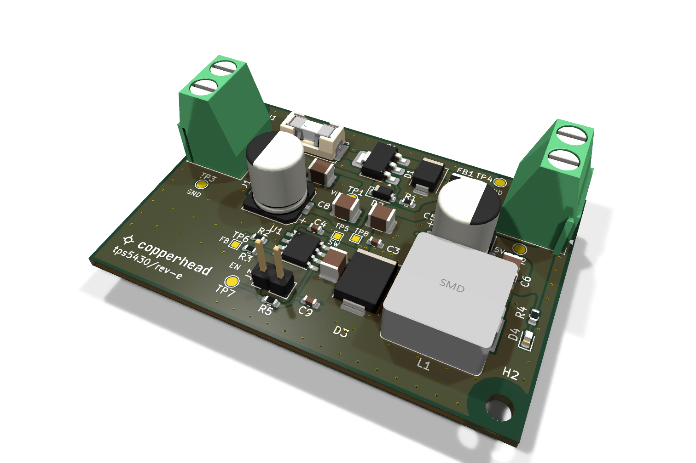

<p>
  
  
</p>

# TPS5430 12 V to 5 V Industrial Buck Converter, rev E

A compact DC/DC converter for an industrial control cabinet. It takes a 12 V supply (9 to 18 V)
and delivers a regulated 5 V at up to 3 A, built around the TI TPS5430 (500 kHz, internally
compensated) with an external Schottky catch diode. Reverse-polarity, transient and fuse
protection at the input; screw terminals at opposite edges. 60 × 40 mm, two layers, 2 oz copper.
Non-isolated: input and output share ground.

> ## ⚠ This board has never been built
>
> - **Never fabricated, never powered.** Neither rev E nor the earlier rev D has been built. Nothing
>   here has been tested on real hardware. Until bring-up passes, every number below is a design
>   value, not a measurement.
> - **Parts are checked on paper only.** Every fitted figure in [`docs/BOM.md`](docs/BOM.md) was
>   checked against its manufacturer datasheet, and the LCSC numbers and stock come from the
>   JLCPCB parts API on 2026-11-06. Stock changes; check it again before ordering.
> - **Not checked:** the gerbers in a viewer, JLCPCB's DFM report, placement rotations in
>   JLCPCB's preview, loop stability, EMC, and thermal performance at 3 A and 50 °C.
> - **One open question:** in a sustained short on the 5 V output, the TPS5430's 4 to 6 A current
>   limit could overload the 5 A catch diode D3. A shorted-output bench test decides between a
>   larger diode and an external fuse on the 5 V wiring (see [`fab/rev-e/README.md`](fab/rev-e/README.md)).
> - **The schematic title block still says "Rev: A".** The revision letter in this repository is
>   the one to go by.
>
> Passing ERC and DRC means the copper matches the schematic and a rule set. It is not evidence
> that the circuit works.



*Renders, not photographs, with every footprint populated. C7, C8, C10 and J3 are drawn for reference but are not fitted on assembled rev E boards.*

## The circuit

[](docs/schematic.pdf)

- **Input and protection:** a 4 A slow-blow fuse in a replaceable SMD holder (Littelfuse
  0154004.DRT), a DMP6023LE P-MOSFET against reverse polarity (no damage from -18 V) with a
  zener gate clamp, and an SMBJ18A TVS.
- **Optional EMI filter:** footprints for an input filter. Rev E ships with it bridged by FB1;
  C7 and C8 are not fitted. A footprint for a 100 µF bulk input capacitor (C10) is there for
  long field cables, also not fitted. The EN header J3 is not fitted either.
- **Buck stage:** TPS5430 with a 15 µH shielded inductor (Bourns SRP1265A-150M), a B560C
  catch diode and 10 µF + 10 µF + 100 nF input capacitors. The 10 µF C1 sits on U1's VIN and
  GND pins and closes the switching loop with D3 (about 30 mm², 6.9 nH, calculated).
- **Output:** 220 µF hybrid and 22 µF ceramic capacitors, and a 0.1 % divider (10.0 k / 3.24 k)
  setting 4.99 V, within ±3 % over the datasheet reference range. The divider senses the output
  at C5 through its own trace.
- **Interface:** Phoenix MKDS 1,5/2-5.08 screw terminals for input (J1, left edge) and output
  (J2, right edge), wire openings facing outward. A green LED shows that 5 V is present; the
  TPS5430 has no power-good output. An unfitted 2-pin header (J3), linked to EN through R5, can
  pull EN low to disable the converter. Eight test pads: VIN, 5V, SW, FB, EN and three GND,
  one of them beside SW for a short scope ground.

### What changed from rev D

- The switching loop is tighter: C1 on the regulator's pins, D3 moved up, one short input hop.
- The switch-node copper pours are gone; D3 is cooled from its ground side.
- Ground stitching is regular: a ring around the switch node, a fence along the edges and a
  grid, 170 vias.
- Curved teardrops on pads, vias and track joints.
- New: the SW ground test pad (TP8), the C10 footprint and the R5 EN link.

The design documents are in [`docs/`](docs/):

- [`BRIEF.md`](docs/BRIEF.md): what was asked for.
- [`SPEC.md`](docs/SPEC.md): the specification derived from the brief.
- [`SUBSYSTEMS.md`](docs/SUBSYSTEMS.md): the circuit, block by block.
- [`PINOUT.md`](docs/PINOUT.md): the connectors and test points.
- [`BOM.md`](docs/BOM.md): every part, with its reason and its datasheet check.
- [`DECISIONS.md`](docs/DECISIONS.md): the design's decisions.

### The board

From [`docs/BOARD-STATS.md`](docs/BOARD-STATS.md):

- **Size:** 60 x 40 mm, 1.6 mm thick, two M3 mounting holes.
- **Stackup:** two copper layers, 2 oz (70 µm), both carrying a GND pour stitched by 170 vias.
- **Parts:** 37 footprints, all on the top: 24 SMD, 3 through-hole (J1, J2, J3), and the test
  pads and mounting holes. 23 are fitted.
- **Routing:** 178 vias (0.3 and 0.4 mm drill), 13 nets, power paths 1.0 to 2.5 mm wide,
  48 teardrops and 23 curved fillets.



*Every footprint populated, including the unfitted C7, C8, C10 and J3.*

## Layout of this repository

```text
hardware/   KiCad project: schematic, board, design rules, vendored symbols and 3D models
docs/       brief, design documents, board statistics, schematic as PDF and SVG
fab/        gerbers, drill, BOM and CPL for rev E and rev D (read the README in each folder)
images/     renders of the board, not photographs
3d/         STEP, GLB and STL models
LICENSES/   full text of the licences below
```

## Building it

1. **Open:** use KiCad 10.0.6 or later on
   `hardware/tps5430-12-v-to-5-v-industrial-buck-converter.kicad_pro`. The symbols are vendored
   in `hardware/sym-lib-cache/` (through `sym-lib-table`), and the fuse and inductor models are
   in `hardware/lib/3d/`, so it opens without extra libraries.
2. **Fab files:** read [`fab/rev-e/README.md`](fab/rev-e/README.md) first. The files are the
   rev E release unchanged; the README lists what has not been checked. The rev D files stay in
   [`fab/rev-d/`](fab/rev-d/) for reference.
3. **On the JLCPCB order form:**
   - select 2 oz outer copper (the gerbers do not set it)
   - J1/J2 holes at least 1.3 mm finished
   - keep the vias tented
4. **In the placement preview:** J1's wire openings must face the left edge and J2's the right
   edge. A 180° rotation error turns them back into the board.
5. **J1 and J2 are through-hole:** they need JLCPCB through-hole assembly or hand soldering.

## Licence

| What | Licence |
|---|---|
| Hardware: everything under `hardware/`, `fab/` and `3d/` | **CERN-OHL-S-2.0** (strongly reciprocal) |
| Documentation and images: `docs/`, `images/`, `README.md` | **CC-BY-4.0** |

Full texts are in [`LICENSES/`](LICENSES/). See [`LICENSE`](LICENSE) for the per-directory
statement.

**No warranty.** CERN-OHL-S-2.0 sections 8 and 9 apply: no warranty, no liability.
