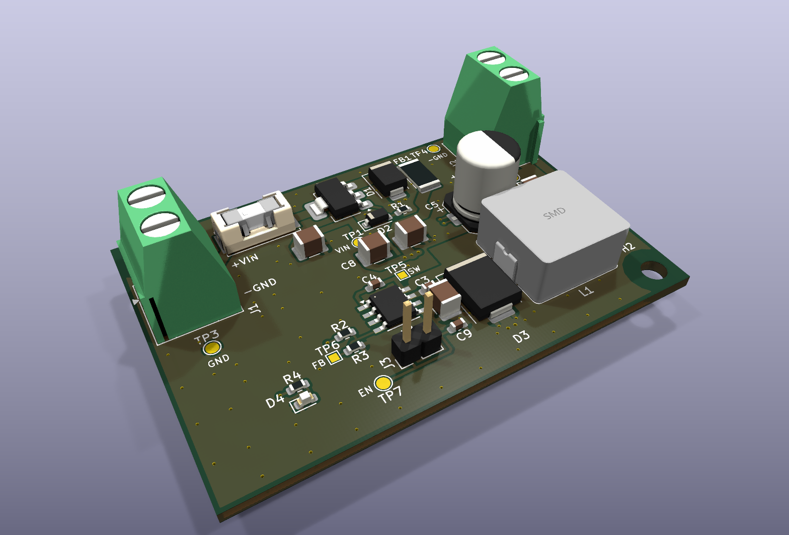

# TPS5430 12 V to 5 V Industrial Buck Converter, rev D

A compact DC/DC converter for an industrial control cabinet. It takes a 12 V supply (9 to 18 V)
and delivers a regulated 5 V at up to 3 A, built around the TI TPS5430 (500 kHz, internally
compensated) with an external Schottky catch diode. Reverse-polarity, transient and fuse
protection at the input; screw terminals at opposite edges. 60 × 40 mm, two layers, 2 oz copper.
Non-isolated: input and output share ground.

> ## ⚠ This board has never been built
>
> - **Never fabricated, never powered.** Nothing here has been tested on real hardware. Until
>   bring-up passes, every number below is a design value, not a measurement.
> - **Parts are checked on paper only.** Every fitted figure in [`docs/BOM.md`](docs/BOM.md) was
>   checked against its manufacturer datasheet, and the LCSC numbers and stock come from the
>   JLCPCB parts API on 2026-11-06. Stock changes; check it again before ordering.
> - **Not checked:** the gerbers in a viewer, JLCPCB's DFM report, placement rotations in
>   JLCPCB's preview, loop stability, EMC, and thermal performance at 3 A and 50 °C. D3 (about
>   1.2 to 1.5 W at full load) is the part to watch.
> - **Two layout items are deferred** (see [`fab/rev-d/README.md`](fab/rev-d/README.md) and
>   [`docs/SUBSYSTEMS.md`](docs/SUBSYSTEMS.md)): C3 has no top-layer ground return, and C2 sits
>   about 12 mm from U1, so it acts as bulk capacitance only.
> - **The schematic title block still says "Rev: A".** The schematic did not change from rev A
>   to rev D; the revision letter in this repository is the one to go by.
>
> Passing ERC and DRC means the copper matches the schematic and a rule set. It is not evidence
> that the circuit works.


## The circuit

[](docs/schematic.pdf)

- **Input and protection:** a 4 A slow-blow fuse in a replaceable SMD holder (Littelfuse
  0154004.DRT), a DMP6023LE P-MOSFET against reverse polarity (no damage from -18 V) with a
  zener gate clamp, and an SMBJ18A TVS.
- **Optional EMI filter:** footprints for an input filter. Rev D ships with it bridged by FB1;
  C7 and C8 are not fitted.
- **Buck stage:** TPS5430 with a 15 µH shielded inductor (Bourns SRP1265A-150M), a B560C
  catch diode and 10 µF + 10 µF + 100 nF input capacitors.
- **Output:** 220 µF hybrid and 22 µF ceramic capacitors, and a 0.1 % divider (10.0 k / 3.24 k)
  setting 4.99 V, within ±3 % over the datasheet reference range.
- **Interface:** Phoenix MKDS 1,5/2-5.08 screw terminals for input (J1, left edge) and output
  (J2, right edge), wire openings facing outward. A green LED shows that 5 V is present; the
  TPS5430 has no power-good output. An unfitted 2-pin header (J3) can pull EN low to disable the
  converter. Seven test pads: VIN, 5V, SW, FB, EN and two GND.

The design documents are in [`docs/`](docs/):

- [`BRIEF.md`](docs/BRIEF.md): what was asked for.
- [`SPEC.md`](docs/SPEC.md): the specification derived from the brief.
- [`SUBSYSTEMS.md`](docs/SUBSYSTEMS.md): the circuit, block by block.
- [`PINOUT.md`](docs/PINOUT.md): the connectors and test points.
- [`BOM.md`](docs/BOM.md): every part, with its reason and its datasheet check.
- [`DECISIONS.md`](docs/DECISIONS.md): the design's decisions.

### The board

From [`docs/BOARD-STATS.md`](docs/BOARD-STATS.md):

- **Size:** 60 x 40 mm, 1.6 mm thick, two M3 mounting holes.
- **Stackup:** two copper layers, 2 oz (70 µm). Both layers carry a GND pour; the switch node
  has copper on both layers under D3 and L1 to spread D3's heat.
- **Parts:** 34 footprints, all on the top: 22 SMD, 3 through-hole (J1, J2, J3), and the test
  pads and mounting holes.
- **Routing:** 121 vias (0.3 mm drill), 14 nets, power paths 1.0 to 2.5 mm wide.



## Layout of this repository

```text
hardware/   KiCad project: schematic, board, design rules, vendored symbols and 3D models
docs/       brief, design documents, board statistics, schematic as PDF and SVG
fab/        gerbers, drill, BOM and CPL for rev D (read the README in that folder)
images/     renders of the board, not photographs
3d/         STEP, GLB and STL models
LICENSES/   full text of the licences below
```

## Building it

1. **Open:** use KiCad 10.0.6 or later on
   `hardware/tps5430-12-v-to-5-v-industrial-buck-converter.kicad_pro`. The symbols are vendored
   in `hardware/sym-lib-cache/` (through `sym-lib-table`), and the fuse and inductor models are
   in `hardware/lib/3d/`, so it opens without extra libraries.
2. **Fab files:** read [`fab/rev-d/README.md`](fab/rev-d/README.md) first. The files are the
   rev D release unchanged; the README lists what has not been checked.
3. **On the JLCPCB order form:**
   - select 2 oz outer copper (the gerbers do not set it)
   - J1/J2 holes at least 1.3 mm finished
   - keep the vias tented
4. **In the placement preview:** J1's wire openings must face the left edge and J2's the right
   edge. A 180° rotation error turns them back into the board.
5. **J1 and J2 are through-hole:** they need JLCPCB through-hole assembly or hand soldering.

## Licence

| What | Licence |
|---|---|
| Hardware: everything under `hardware/`, `fab/` and `3d/` | **CERN-OHL-S-2.0** (strongly reciprocal) |
| Documentation and images: `docs/`, `images/`, `README.md` | **CC-BY-4.0** |

Full texts are in [`LICENSES/`](LICENSES/). See [`LICENSE`](LICENSE) for the per-directory
statement.

**No warranty.** CERN-OHL-S-2.0 sections 8 and 9 apply: no warranty, no liability.
